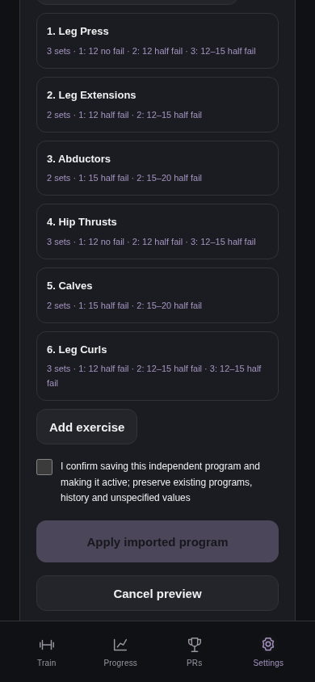

# Pages training-plan import regression

The supplied Pages document now previews **one week, two workout types, six exercises per workout and zero unresolved warnings**. All 29 numbered sets retain their original rep ranges and effort instructions. Friday / Sunday stays one alternative schedule; the introductory “first 2 weeks” guidance does not create a rotation.

Pages extraction reads typed text-storage records from the IWA archive, preserving paragraph and Unicode soft-line boundaries. DOCX extraction also preserves soft breaks and paragraph boundaries. The parser accepts alternative days, numbered exercises and split prescriptions, while retaining actual missing/duplicate-set warnings. Introductory guidance, optional walking, warm-ups and effort definitions are editable plan notes and survive program backup/restore. Older programs without the optional notes field remain valid.

Previewing does not save anything. Applying still requires explicit confirmation. Existing saved history, active workouts and installed plans are not migrated or automatically replaced. The existing GYM compatibility adapter is unchanged.

## iPhone-sized browser previews

Captured at 390 × 844 in mobile Chromium; these are browser previews, not physical-iPhone screenshots.

[Overview](screenshots/girlfriend-plan-iphone.png) · [All six Leg Day prescriptions](screenshots/girlfriend-leg-prescriptions-iphone.png) · [Upper Body & Core](screenshots/girlfriend-upper-iphone.png)

## Coverage and limits

The original `.pages` archive is committed as a regression fixture; tests verify extraction independently from parsing, all 12 exercise names and 29 set targets, alternative schedules, Unicode/paragraph boundaries, split set lines, notes, backup compatibility and confirmation. Existing GYM/basic plan, TXT, DOCX, PDF, CSV and XLSX coverage is retained. The importer browser suite also runs in the existing WebKit CI job.

Modern IWA Pages documents are supported. Malformed, encrypted or older unsupported Pages archives are rejected with an instruction to export DOCX/TXT. Multiple text flows require reading-order review; image-only documents still require external OCR. Imported source content is treated only as data.
