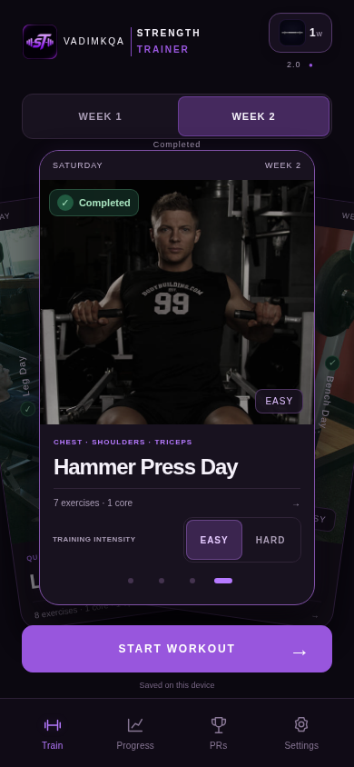
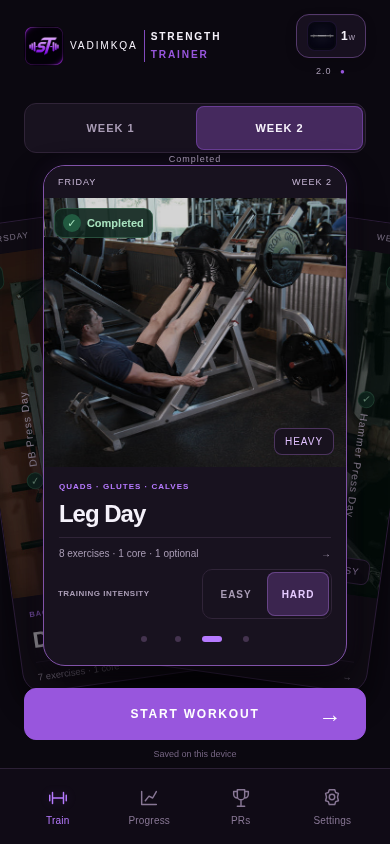

# Saved workout completion on Train

The carousel and calendar recommendations now share a read-only occurrence matcher. The previous eligibility check rejected an otherwise saved workout whenever any required exercise/set was not performed, so finished sessions with skipped or changed work could still be suggested as catch-up.

A valid saved session has real completion timestamps, no running set or unresolved/invalid completed logging, and at least one valid performed set. It need not reproduce the template's exercise list or complete every planned set. Explicit test/cancelled/abandoned sessions do not count. The checkbox named **Exclude from Strength Streak** affects streak counting only; it no longer hides a valid saved completion from Train.

Matching requires:

- The active program's exact ID, or unambiguous ownership of the exact template ID for older records without program IDs.
- The scheduled occurrence's exact template ID; display names, similar exercise names, intensity and date alone never link unrelated workouts.
- Matching cycle week when the record provides one.
- An exact `scheduledFor` date when present. Older records without that reference use the Vienna calendar week in which the session started, paired with the exact template. This allows within-week make-up sessions and overnight finishes without rewriting history. Ambiguous program ownership is left unmatched.

All calendar dates use **Europe/Vienna**, including DST and midnight. The displayed rotation week maps to the current calendar week when applicable; another viewed cycle uses the upcoming recommendation's week if that is the recommendation, otherwise its most recent scheduled week. This rule does not depend on which card is in front. Each new rotation occurrence starts incomplete; a past completion never fills a different occurrence.

The selected card shows **Completed**, replacing a catch-up/today/next label when appropriate. Completed side-card photos have a subtle emerald tint and small edge checks. Foreground cards retain their normal photos and purple border with a compact green completion badge. Original image assets are untouched. A repeat requires explicit confirmation and creates a separate active session ID; selecting a card or dismissing confirmation creates no history entry.

Statuses use committed history and recalculate after successful save, deletion, restore, program switch, day change and reload. Accepting saved data also refreshes the UI clock atomically: a newly finished session cannot be treated as a future timestamp until the next one-second tick. New manual starts retain the selected occurrence's `scheduledFor` date where schedule metadata supports it. No existing workout is migrated or rewritten. Missing calendar/weekday metadata is not guessed.

Streak calculation is unchanged: it counts distinct qualifying completion dates, independently of template occurrence matching. No new completion flags or counters are persisted. Backups, timers, imported plans and history retain their existing storage formats.

## Review

Run `npm run test:workflow`, `npm test`, `npm run build` and `npm run test:e2e`. CI also runs the completion tests in WebKit. Regressions include a Week 2 Easy Hammer Press session on 14 November 2026 with 16 performed sets and duration 01:41:54, partial/skipped prescriptions, same-day revisits, rotation boundaries, a two-day program, midnight/DST, exact identities, repeat confirmation, manual navigation, actual save/delete/backup restore, program switching and reload. Tests use isolated browser fixtures; they do not access or clear the user's production device data.

Screenshots at 390×844:

Before merging, review on an installed iPhone PWA with your existing history. A history record lacking reliable program/template/schedule metadata is deliberately not guessed from its visible workout name. This is a data-sensitive change and remains for manual review; no auto-merge or deployment is requested.
