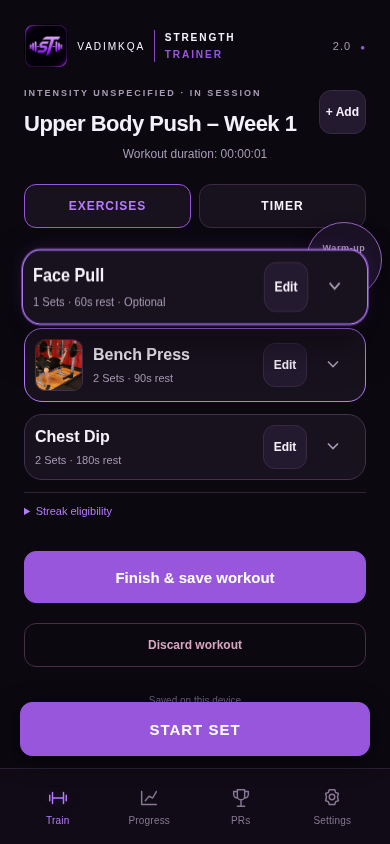
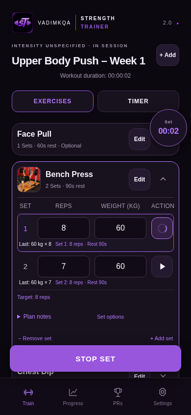

# Reorder exercises during a workout

In **Exercises**, hold an exercise's title for about half a second, then drag up or down. A purple outline and lift indicate that sorting is active. Hold near the screen's upper or lower edge to scroll the list, then release to save. A short tap still expands or collapses a card. Inputs, Edit, chevrons, set controls and the floating stopwatch do not activate sorting. Mouse dragging uses the same hold interaction.

For keyboard or assistive technology use, expand a card, open **Set options**, and use **Move up / Move down**. Changes are announced. Escape cancels an active drag. Haptic feedback is optional and only used when the browser provides vibration; iPhone Safari may not.

Only the active session's exercise array changes. Existing exercise/set IDs, records, previous performance, expansion state and controller timestamps are retained. The existing IndexedDB save queue writes the new order. Reloading or resuming uses that array. Imported templates and previously completed history are untouched. After finishing or skipping a set, progression follows the updated session order. At the end it returns to any earlier unfinished rows, so moving a card above a running set cannot strand its remaining sets. Nothing starts automatically; a fully resolved session still offers Finish Workout.

The implementation uses dnd-kit with delayed touch/mouse sensors, vertical sortable transforms, edge scrolling and reduced-motion support. Normal vertical scrolling cancels an unactivated hold; a started drag cannot become an Exercises/Timer swipe. Numeric inputs keep their existing font sizes and native touch behavior.

## Review

```sh
npm ci
npm test
npm run build
npm run preview -- --port 4173
# Open http://localhost:4173/strength-tracker/
npm run test:e2e
```

Automated coverage includes ID/data preservation, complete/optional/skipped exercises, running and unresolved sets, subsequent progression, IndexedDB reload, saved history, cancelled holds, keyboard movement, real Chromium touch events, mouse movement, normal vertical scrolling, and top/bottom edge scrolling at iPhone dimensions. The full existing suite also covers set logging, viewport/keyboard simulation, timers, backup and offline reload.

Browser emulation cannot verify physical iPhone Safari/PWA touch arbitration, actual keyboard behavior or haptic support. Before merging, check a hold/drag and scroll on an installed iPhone PWA. The feature is available offline after the usual successful PWA update; no service or permission is required.




