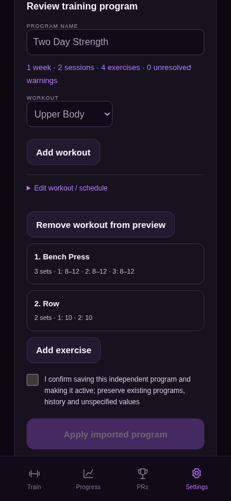
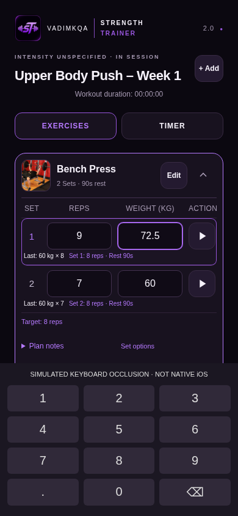

# iPhone logging and flexible-import reliability fix

This is a data-sensitive, manual-review update. It makes no database migration, clears no browser storage and rewrites no existing saved workouts or programs.

## Layout investigation and fix

The old hook calculated `innerHeight - visualViewport.height - offsetTop` and applied that estimate to fixed navigation, the set controller and document padding. It also inferred keyboard state from height thresholds, cleared state on blur before dismissal finished, and did not refresh on app return. Safari can pan the visual viewport or resize its layout viewport; fixed elements need not follow the Chromium-emulated model. Combining those coordinate systems could compensate twice, expose navigation during dismissal, and create large artificial scroll areas.

The old form also retained a 190px input scroll margin plus navigation scroll padding, clipped card bodies with `overflow:hidden` (a potential nested focus-scroll container), and translated the exercise panel during screen entry.

The fix uses one document scroller, native fixed anchoring and a focus-owned editing mode:

- No keyboard-height CSS variable, calculated bottom offset, viewport-sized page padding or baseline-height guess remains. visualViewport is used only to reveal an actually occluded input using its measured bounds; manual pinch zoom remains available.
- While typing, fixed navigation and the floating timer bubble are temporarily hidden. The **same** Start/Stop controller stays in normal flow. A reserved controller footprint prevents changing document length when it returns to floating mode. Timers keep using their existing timestamps.
- **Done editing** is in the exercise's existing Add/Remove footer row, so input rows/columns do not grow or move when typing. A short quiet period after blur/viewport events restores chrome after dismissal; this delay controls visibility, never an offset. Checkboxes do not enter keyboard mode.
- Focus, viewport resize/pan, pageshow and visibility return are handled without resetting the scroll position, session or entered values. Ordinary document scrolling does not continually snap back to the focused field.
- Card bodies use `overflow:clip`, not an internally scrollable hidden-overflow region. Screen-entry transitions only fade. Per-card column headings remain ordinary, non-sticky content.
- Long-press sensors refuse activation during text editing/dismissal. After Done, the existing sortable implementation works normally. A drag never starts/stops/completes a set. The floating stopwatch returns with its saved normalized position.

Existing ≥16px controls, accessible touch sizes, safe-area spacing, exercise IDs, set IDs, expansion state, logging actions, previous performance and persistence are retained.

## Importer fix

An unspecified optional target is not a parsing error. New previews keep absent intensity, set count, rep targets, weight, RPE/RIR and rest as null/empty values. They do not request acknowledgement of those omissions or invent a prescription. Rep ranges render normally without intensity. Ordinary notes/instructions are retained as source notes rather than manufactured exercises or warnings.

Missing/duplicate set numbers, conflicting intensity labels, contradictory/ranged set counts, unparseable or multiple rest/RPE/RIR targets, unitless explicit weights and unsupported/truncated sections still require review. Structural errors such as an empty workout/exercise name remain blocking. Applying an import still needs explicit confirmation and the existing pre-import backup transaction.

Unclassified plans, including familiar Bench Day / Leg Day names, use the generic program parser rather than the legacy Hard/Easy validator. The established classified legacy/GYM adapter remains for compatible programs. The normalized model already drives actual session counts, chronological weekdays, rotation lengths, program switching and calendar selection; no four-day/two-week fallback is introduced. Single-week previews do not show a week selector. Existing independently imported programs and all completed performance remain separate and untouched.

## Verification and review

```sh
npm ci
npm test
npm run build
npm run test:e2e
npm run preview -- --port 4173
# http://localhost:4173/strength-tracker/
```

The independent `Mobile reliability regressions` CI workflow runs the full Chromium suite and the targeted keyboard/import/reorder tests in Playwright WebKit. It does not change the Pages deployment workflow or enable auto-merge. Run the WebKit target locally where installed with:

```sh
npx playwright install --with-deps webkit
REGRESSION_BROWSER=webkit npx playwright test --config playwright.regression.config.ts
```

Tests cover both panned visual and resized layout viewport models, focus/blur, keyboard dismissal, standalone flags, input accessibility, navigation, background return, running timers, long-press cancellation/reordering, reload/persistence, optional information, one-week 1/2/3/5/6-session plans, explicit multiweek rotations, genuine ambiguities, calendar mapping and preserving existing history/programs. No app-data cleanup is used to make tests pass.

### Physical iPhone verification still required

Chromium emulation and desktop headless WebKit do **not** run iOS Safari's native keyboard, viewport compositor or installed-PWA lifecycle. Standalone flags and viewport changes in these tests are simulations. The keyboard screenshot below deliberately labels its test-only occlusion overlay; it is not a photograph/capture of a native iOS keyboard.

Before merging, verify on actual iPhones (375×667, 390×844 and 393×852 where available), in Safari and an installed standalone PWA on an isolated HTTPS preview origin:

1. Start a workout. Enter weight/reps in first and later exercises; move between rows. Scroll vertically with the keyboard open. Check that all inputs remain reachable and columns stay aligned.
2. Press Done editing; open/close the keyboard repeatedly. Navigation should return at the native bottom, never remain in the middle; the shared controller should float again above it.
3. Start a set, edit logging, switch apps/lock for several minutes, return and resume. Verify the active spinner, entered values and elapsed timer. Stop the set normally.
4. A header hold while typing must not steal focus or reorder. After Done, reorder both completed/unfinished cards, then reload and verify order, weights/reps, active set and timing.
5. Check portrait/landscape changes, Safari toolbar expansion/collapse and safe-area/home-indicator spacing. Confirm normal Exercises/Timer swiping after leaving input editing.

Do not reset the production PWA's storage or reimport existing plans for this test. This PR is left for manual review and has no auto-merge request.




