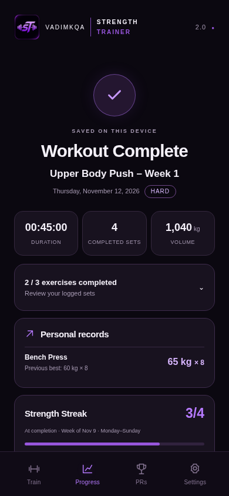
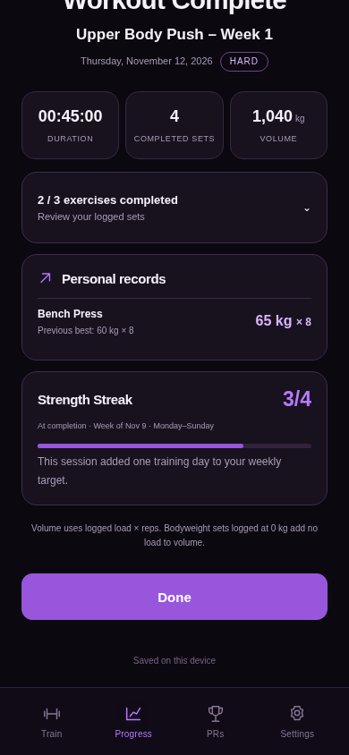

# Workout completion summary

Both finish controls now use the same guarded save path. The app waits for earlier edits, locks editing briefly, calls the existing workout-finishing and streak functions, and commits the resulting state to IndexedDB before showing **Workout Complete**. The workout, final rest interval and streak updates are saved together. The active session stays available when saving fails; **Retry saving** reuses its ID and original finish timestamp. Continuing to edit instead starts a fresh finish attempt. Double taps cannot launch another completion.

The summary includes session duration, valid completed sets, logged training volume, exercise completion and an expandable set review, personal improvements, and weekly streak progress. **Done** returns to Train. **Progress → View workout summary** reopens a read-only view of the saved session, including while a different workout is running. Reloading uses the existing history; no extra receipt record or database migration is needed.

## Calculation rules

- Progress, history, PRs and the summary share helpers for valid logged performance. A set needs its completion flag, valid weight and positive whole-number reps; skipped and unresolved sets are excluded. Skipping the rest of an exercise never erases its already completed sets.
- Exercise completion uses the existing exercise-card rule. Skips are not successful completion. Unperformed optional exercises remain visible as unfinished rather than being fabricated or counted.
- Volume is actual logged kg × reps. Zero kg is valid for bodyweight/added-load logging and contributes zero volume; no body mass, target load or suggested performance is invented.
- PRs use the existing highest-weight comparison, with higher reps breaking equal-weight ties. The summary labels an improvement only when earlier valid history provides a baseline. Names remain exact, so similarly named variants are not combined. First-time exercises receive neutral baseline messaging.
- Historical summaries compare saved sessions through their completion timestamp, so future workouts cannot claim an earlier PR or unlock. Counts and achievements are recalculated from the currently saved history and existing weekly goal snapshots; corrections to history remain respected.
- Strength Streak continues using distinct completed dates in Europe/Vienna, its existing Monday–Sunday weekly targets, exclusions and milestone thresholds. The summary reports whether the session increased the target count, including same-day/extra-workout explanations. Weekly qualification and new milestones get restrained celebrations using the existing artwork. Crystal and the secret remain separate; the red pose is rendered only after its existing 52-week condition is verified.

No imported plans, workout records, artwork, backup schema, carousel or logging controls are replaced. The existing JSON backup retains all source data needed to reconstruct summaries. The production bundle and existing precache provide offline access.

## Review

```sh
npm ci
npm test
npm run build
npm run preview -- --port 4173
# http://localhost:4173/strength-tracker/
npm run test:e2e
```

New tests cover commit delays and failures, retry timestamps, duplicate prevention, final rest/set timing, numeric validation and bodyweight volume, PR baselines/ties/variants/future history, streak daily credit and milestones, JSON/IndexedDB reload, mobile layout and focus, offline history review, and uninterrupted active sessions. Existing finish-flow tests now review the completion screen before returning to history/PRs.

Screenshots use isolated sample data at 390×844. Browser coverage uses mobile Chromium emulation, not physical iPhone Safari or a real iOS keyboard.




